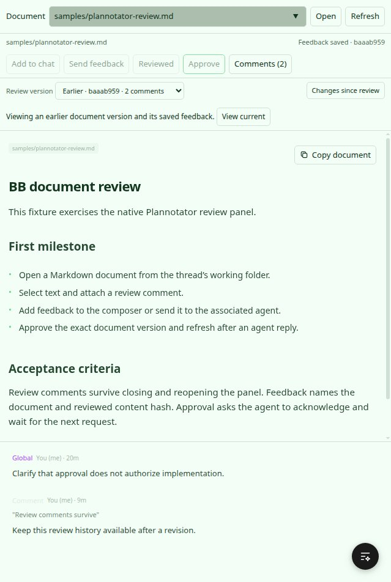
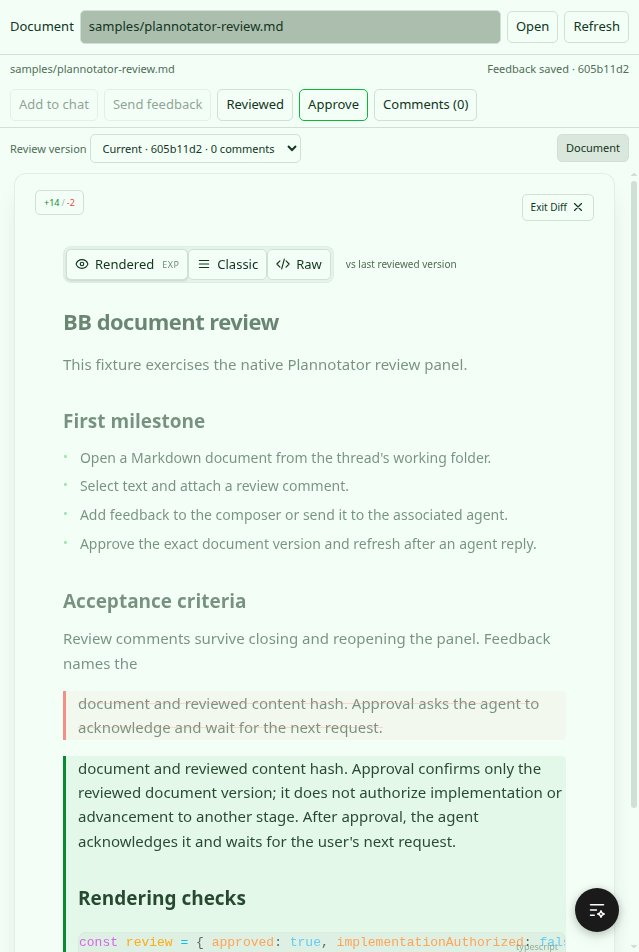

# Plannotator for BB

Native document review built from this fork’s UI/core workspace sources. BB owns the conversation and file access; Plannotator renders and annotates the document.

Open **Plannotator** in a thread’s side-panel tabs, choose a checkout-relative Markdown file, select text or add a global comment, then choose **Add to chat**, **Send feedback**, **Reviewed**, or **Approve**. Approval applies only to the displayed content hash and tells the agent to acknowledge and wait.

Feedback is stored per thread, working-folder identity, document, and content hash. Earlier review versions remain available when an agent edits the file. File changes and working-folder moves invalidate direct send/approval until refresh. Existing composer drafts and attachments are preserved.

## Development

From the fork root:

```sh
bun install --filter bb-plugin-plannotator --ignore-scripts
bun run --cwd apps/bb-plugin-plannotator build
bb plugin install ./apps/bb-plugin-plannotator --yes
```

Progress and verification: [BB integration guide](../../docs/agent-guides/bb-plugin.md).

The first milestone supports UTF-8 `.md` / `.markdown` files up to 256 KiB and 128 KiB of annotations per version. Files remain in their BB checkout. A folder change opens a separate review identity; this plugin does not carry spec folders. Sends queue behind active agent turns. A failed send is recorded as uncertain; check delivery before explicitly resending.

## Native BB captures

Captured from a running BB thread panel using a deterministic review fixture. The history view retains a global comment and a selected-text comment after the document changes.





## Verification

The plugin has 18 passing focused tests and 40 passing shared-UI regression checks, with passing plugin and shared-UI typechecks. See [recorded commands and outcomes](evidence/verification.json) and [generated agent messages](evidence/generated-messages.json).

For a standalone sample in this checkout, open `apps/bb-plugin-plannotator/fixtures/document-review.md`. This milestone is installed from a development checkout; Git/npm release packaging, image attachment/upload support, and workspace-relative image routing are not included.

The SDK’s SQLite test harness needs a native binding. After an install with scripts disabled, run `npm rebuild better-sqlite3 --ignore-scripts=false` from the plugin directory before running its tests.
