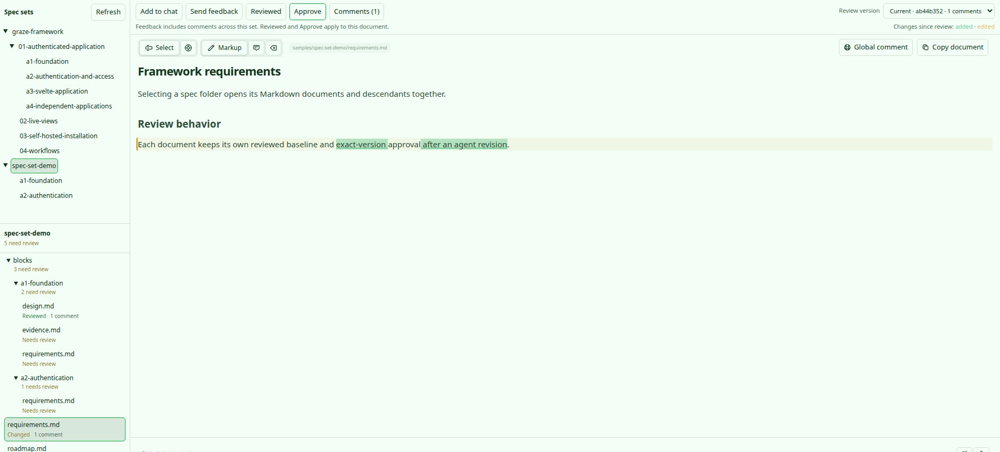

# Plannotator for BB

Native document review and a Beads-backed software factory built from this fork’s UI/core workspace sources. BB owns the conversation and file access; Plannotator renders and annotates the document.

Open **Plannotator** in a thread’s side-panel tabs and choose a spec from the left **Spec sets** tree. Only folders with their own Markdown file containing `requirements` in its filename appear. A spec nests beneath its nearest qualifying ancestor; README-only containers are skipped in this selector. For Graze, blocks 01–04 nest directly beneath `graze-framework`, and A1–A4 beneath 01.

The document tree below it uses the selected spec as its base and shows every folder and file, including empty directories. Markdown documents open in the review viewer on the right; supporting files use BB’s native preview. The selection and last open document are remembered per thread. The native Markdown opener chooses the closest owning spec when one exists.
Review actions sit in a compact header with **Review version** at the upper right. The document toolbar and title follow directly below.

The tree shows **Needs review**, **Changed**, **Reviewed**, or **Reference**, plus comment counts and pending counts on collapsed folders. Never-reviewed documents have no body highlights. Once Reviewed establishes a document’s baseline, subsequent changes appear automatically in the viewer.

**Add to chat** and **Send feedback** combine current-version comments across the set into one prompt. **Reviewed** checks off the displayed document at its exact current version and resets its baseline without sending a message. **Accept** signs off the entire phase and instructs the agent to draft the next phase. Every Requirements boundary includes a sizing assessment and your Continue or Break down decision. Accept Tasks publishes Beads tasks and responsibility/context packs; Start factory separately authorizes execution. Stale set membership, files, feedback revisions, or checkout identity require a refresh before combined feedback can be sent.

Feedback is stored per thread, working-folder identity, document, and content hash. Earlier review versions remain available when an agent edits the file. File changes and working-folder moves invalidate direct send/approval until refresh. Existing composer drafts and attachments are preserved.

## Factory

Expand the workflow bar to initialize/import a spec, adjust phase membership, inspect
acceptance history and context packs, and control a run. Beads must be installed on
the thread's host; the spec workflow automatically reuses an existing workspace or
initializes one without agent hooks. New spec begins with your idea and drafts Requirements in the native chat.

A run takes a workspace setup command (optional), verification command, and native BB
model choices. Defaults are **Codex gpt-6.1-terra / medium** for workers and
**Codex gpt-6.1-sol / xhigh** for reviewers. Two tasks run concurrently in isolated
worktrees. Checks, independent review, and merged-code verification must pass before
closing a bead. Two correction rounds are allowed before a task blocks. Passing work
merges into a retained `factory/<run-id>` branch; the starting branch stays unchanged.
Pause/resume, stop, explicit retry, task thread links and evidence are available in-panel.

See [factory behavior, architecture, limits and progress](../../docs/agent-guides/bb-factory.md)
and [the real disposable-project acceptance result](evidence/factory-live.json).

## Development

From the fork root:

```sh
bun install --filter bb-plugin-plannotator --ignore-scripts
bun run --cwd apps/bb-plugin-plannotator build
bb plugin install ./apps/bb-plugin-plannotator --yes
```

The build generates the browser worker used to parse documents and calculate review changes. After changing the worker or its parser and diff dependencies, run `bun run --cwd apps/bb-plugin-plannotator build:worker` before a direct `bb plugin build` or development reload; the full build above generates it automatically.

Progress and verification: [BB integration guide](../../docs/agent-guides/bb-plugin.md).

A set supports up to 200 UTF-8 `.md` / `.markdown` documents, each up to 256 KiB, with 128 KiB of annotations per version and 128 KiB per combined feedback prompt. Files remain in their BB checkout. A folder change opens a separate review identity; this plugin does not carry spec folders. Sends queue behind active agent turns. A failed send is recorded as uncertain; check delivery before explicitly resending.

## Native BB captures

Captured from a running BB panel using a disposable Graze-shaped example. The spec selector omits the README-only `blocks` ancestor; the separate file tree preserves actual folders and supporting files. Never-reviewed documents remain unhighlighted.



[Completed factory, wide](assets/native-factory-complete-wide.jpg) · [Completed factory, narrow](assets/native-factory-complete-narrow.jpg)

[Compact review header, wide panel](assets/native-compact-review-wide.jpg) · [Narrow panel](assets/native-compact-review-narrow.jpg)

## Verification

The original review milestone recorded 36 focused tests and 43 shared-UI regression checks. The factory adds real-Beads planning/execution/recovery tests and a live Codex acceptance project; current verification records 50 passing plugin tests, with the final eight affected planning tests rechecked after the last planning fixes. See [factory verification](evidence/factory-verification.json). See [recorded commands and outcomes](evidence/verification.json) and [generated agent messages](evidence/generated-messages.json).

For a standalone sample in this checkout, open `apps/bb-plugin-plannotator/fixtures/document-review.md`. This milestone is installed from a development checkout; Git/npm release packaging, image attachment/upload support, and workspace-relative image routing are not included.

The SDK’s SQLite test harness needs a native binding. After an install with scripts disabled, run `npm rebuild better-sqlite3 --ignore-scripts=false` from the plugin directory before running its tests.
